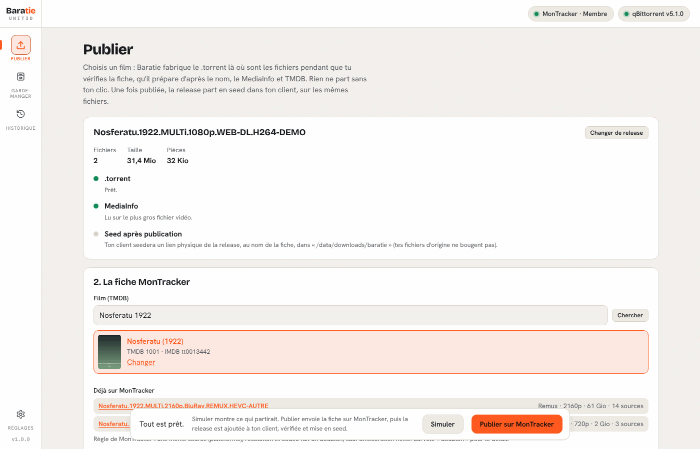
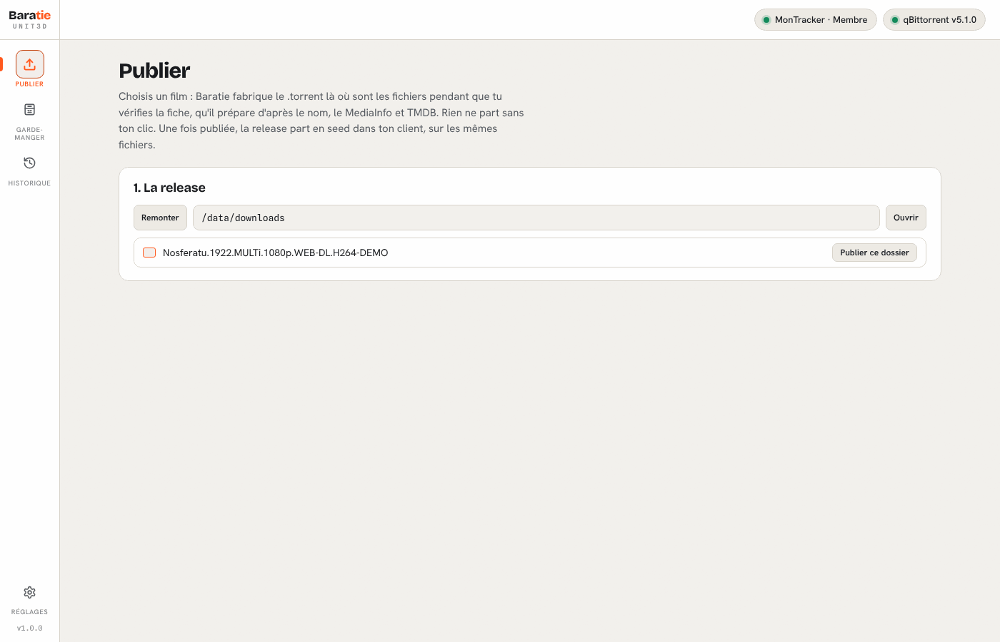
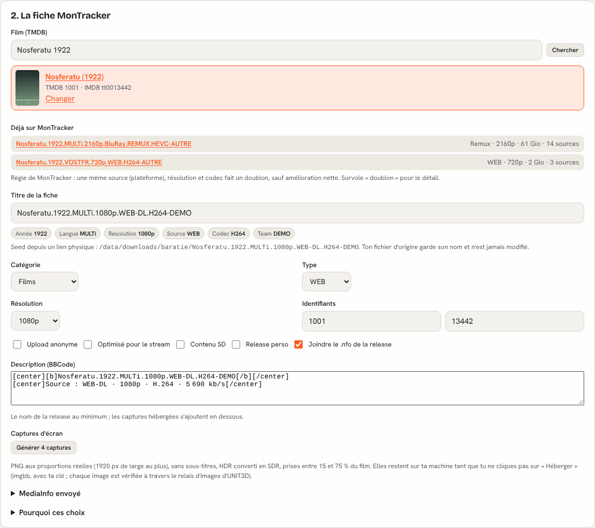
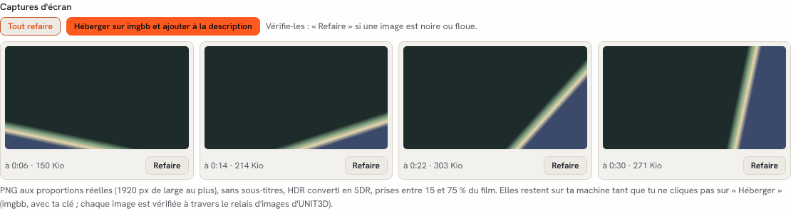
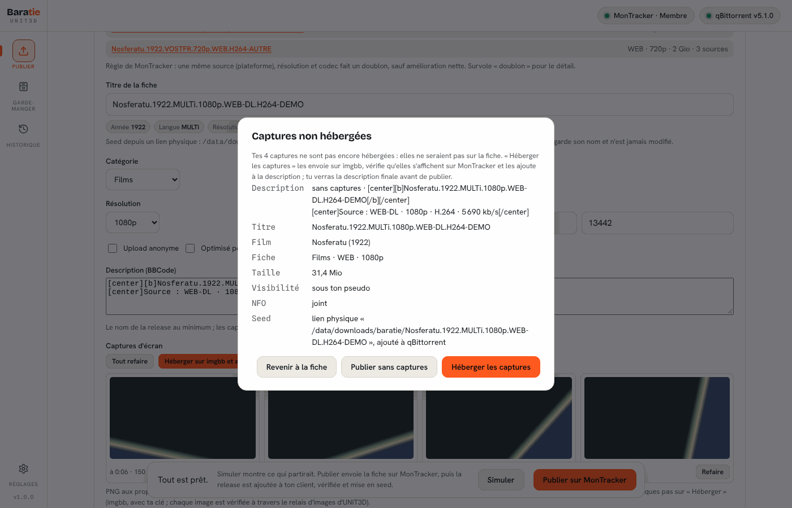
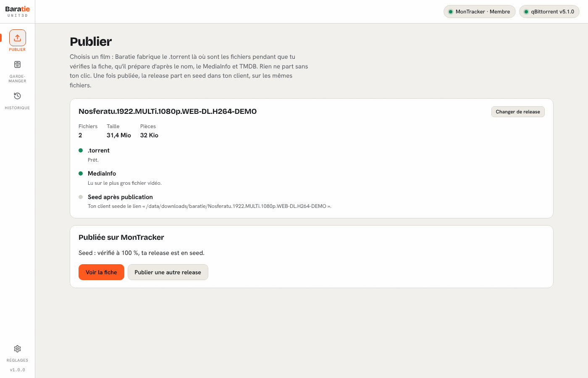
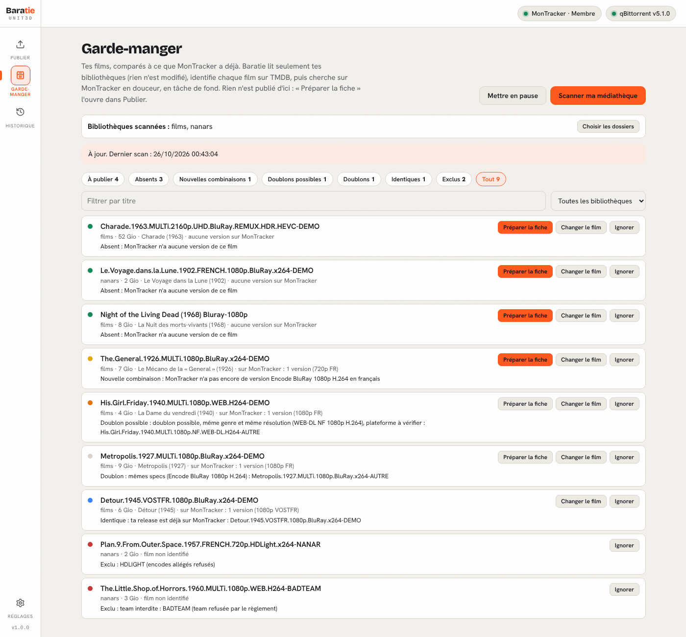
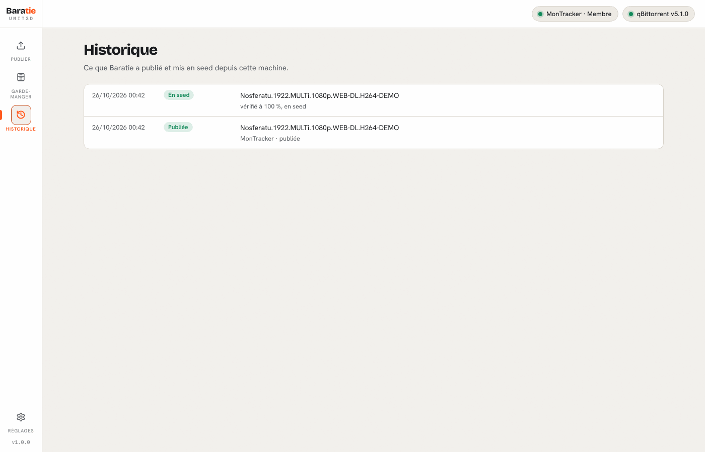
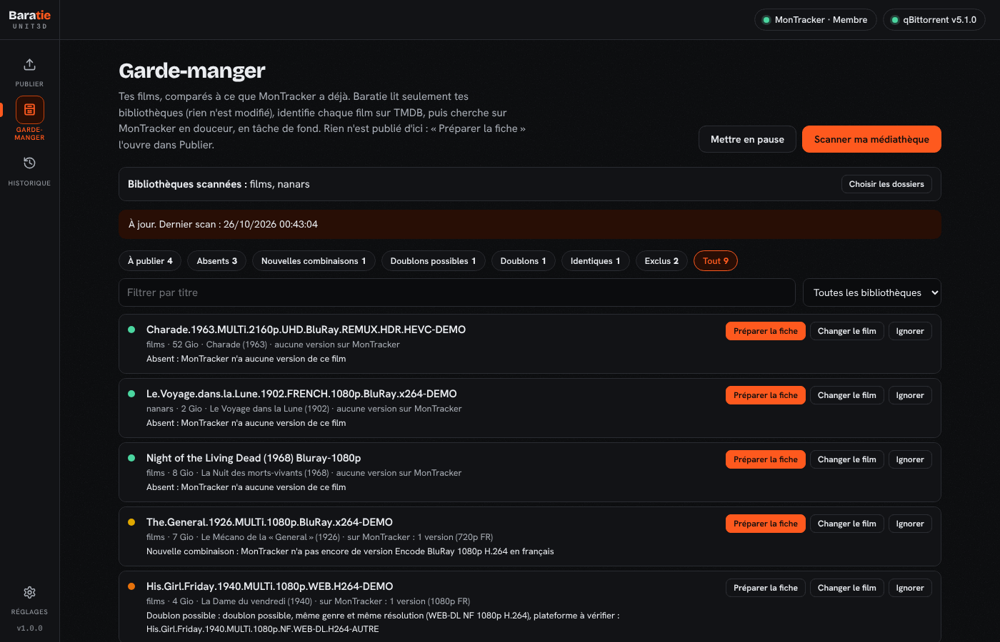
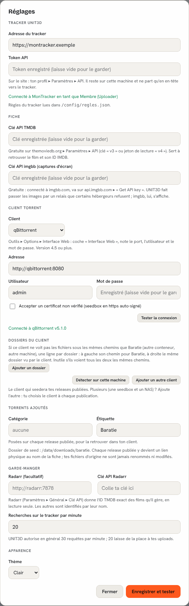

<p align="center">
  
</p>

<h1 align="center">Baratie</h1>

<p align="center">
  <b>Publication assistée de films vers un tracker UNIT3D.</b><br>
  Tu choisis une release, Baratie prépare la fiche, vérifie les règles de ton tracker,<br>
  publie sur ton clic et met la release en seed dans ton client torrent.
</p>

<p align="center">
  <sub>Fork de <a href="https://github.com/V3x0rV3x/D3X">D3X</a>, l'outil de la communauté V3X, repensé pour les trackers UNIT3D.</sub>
</p>

<p align="center">
  
</p>

---

## Sommaire

- [Ce que fait Baratie](#ce-que-fait-baratie)
- [Ce qu'il ne fait jamais](#ce-quil-ne-fait-jamais)
- [Visite guidée](#visite-guidée)
- [Installation](#installation)
- [Premier lancement](#premier-lancement)
- [Le fichier de règles de ton tracker](#le-fichier-de-règles-de-ton-tracker)
- [Seed par liens physiques](#seed-par-liens-physiques)
- [Variables d'environnement](#variables-denvironnement)
- [Sécurité](#sécurité)
- [Compiler soi-même](#compiler-soi-même)
- [Crédits et licence](#crédits-et-licence)

---

## Ce que fait Baratie

Baratie est un petit serveur web (un seul binaire, ou une image Docker) qui tourne **là où sont tes fichiers** : NAS, seedbox, serveur maison ou PC. Tu l'ouvres dans ton navigateur.

- **Fiche préparée toute seule** : titre, catégorie, type, résolution, identifiants TMDB et IMDB, MediaInfo, NFO, description BBCode… d'après le nom de la release, ses pistes et TMDB. Tout reste modifiable avant l'envoi.
- **Règles de ton tracker vérifiées avant l'envoi** : teams interdites, mentions refusées (CAM, HDLight…), sous-titres français pour une VO, langue originale pour un MULTi, conteneur, encodeur, débits minimum… Un blocage empêche la publication, un avertissement te laisse décider. Les règles viennent d'un [fichier JSON](#le-fichier-de-règles-de-ton-tracker) que tu adaptes à ton tracker.
- **Doublons repérés** : Baratie liste ce que le tracker a déjà pour ce film et te dit si ta release est un doublon, une nouvelle combinaison (autre source, résolution ou codec) ou une amélioration.
- **Captures d'écran** : 4 captures PNG prises par ffmpeg (HDR converti en SDR, sans sous-titres), à refaire une par une, hébergées sur imgbb **seulement si tu le demandes**, et vérifiées à travers le relais d'images d'UNIT3D pour ne pas finir en vignettes cassées.
- **Seed automatique** : après publication, le .torrent du tracker est ajouté à ton client (qBittorrent, Transmission, Deluge ou rTorrent), vérifié, puis mis en seed. Avec un [dossier de seed](#seed-par-liens-physiques), la release est recréée en liens physiques au nom exact de la fiche : tes fichiers d'origine ne bougent pas.
- **Garde-manger** : Baratie compare ta médiathèque à ce que le tracker possède déjà et te dit quels films manquent, lesquels apporteraient une nouvelle version, et lesquels sont déjà là.
- **Historique** de ce qui a été publié et mis en seed.
- Thème clair ou sombre, interface en français.

## Ce qu'il ne fait jamais

- **Rien ne part sans ton clic.** Pas d'upload automatique, pas d'envoi en tâche de fond. Le Garde-manger ne fait que *chercher* sur le tracker, en douceur (débit réglable).
- **Tes fichiers ne sont jamais modifiés, renommés ni supprimés.** Baratie lit tes fichiers ; il n'écrit que dans son dossier de configuration et, si tu l'actives, crée des liens physiques dans le dossier de seed.
- **Tes clés restent chez toi.** Token du tracker, clés TMDB et imgbb, mots de passe des clients : rangés dans le dossier de configuration, jamais renvoyés à la page, jamais envoyés ailleurs qu'au service concerné.
- Pas de télémétrie, pas de mise à jour automatique.

---

## Visite guidée

### 1. Choisir la release

Baratie parcourt tes dossiers et fabrique le .torrent pendant que tu vérifies la fiche.



### 2. Vérifier la fiche

Le film est reconnu sur TMDB, les versions déjà présentes sur le tracker sont listées, et chaque champ est expliqué (« Pourquoi ces choix »).

<p align="center"></p>

### 3. Captures d'écran

Prises sur ta machine, hébergées seulement sur un clic.



### 4. Confirmer et publier

Un dernier récapitulatif de ce qui va partir : titre, fiche, taille, NFO, dossier de seed.



### 5. En seed

Le .torrent du tracker est ajouté à ton client, vérifié à 100 %, puis mis en seed.



### Garde-manger

Ta médiathèque comparée au tracker : **Absents** (le tracker n'a pas ce film), **Nouvelles combinaisons** (il l'a, mais pas dans cette source, résolution ou langue), **Doublons possibles** à vérifier, **Doublons**, **Identiques** (ta release exacte y est déjà) et **Exclus** (refusés par les règles). « Préparer la fiche » l'ouvre directement dans Publier.



### Historique, réglages et thème sombre

<p align="center">
  
  
</p>

<p align="center"></p>

---

## Installation

### Ce qu'il te faut

| | |
| --- | --- |
| **Un compte sur un tracker UNIT3D** | avec le droit d'upload et un **token API** (sur le site : ton profil ▸ Paramètres ▸ API) |
| **Une clé API TMDB** | gratuite sur [themoviedb.org](https://www.themoviedb.org/settings/api) |
| **Un client torrent** | qBittorrent 4.5+, Transmission, Deluge ou rTorrent, avec son interface web activée |
| **Une clé API imgbb** *(facultatif)* | pour héberger les captures : gratuite sur [api.imgbb.com](https://api.imgbb.com/) |
| **ffmpeg / ffprobe** | déjà dans l'image Docker ; à installer toi-même pour le binaire seul |

### Docker (recommandé)

Une image prête à l'emploi (amd64 et arm64) est publiée avec chaque version :

```bash
docker pull ghcr.io/santoryu-d/baratie:latest
```

Exemple de `docker-compose.yml` (aussi fourni à la racine du dépôt, avec `build: .` pour construire l'image toi-même) :

```yaml
services:
  baratie:
    image: ghcr.io/santoryu-d/baratie:latest
    container_name: baratie
    restart: unless-stopped
    user: "1000:1000"            # UID:GID du propriétaire de tes fichiers (commande « id »)
    ports:
      - "8769:8769"
    environment:
      - BARATIE_SEED_DIR=/data/torrents/baratie   # facultatif, voir « Seed par liens physiques »
      - BARATIE_MEDIA=/data
      - TZ=Europe/Paris
    volumes:
      - ./config:/config
      - /chemin/vers/tes/medias:/data              # même chemin que dans ton client torrent
```

```bash
docker compose up -d
docker logs baratie        # affiche le lien d'accès, avec son jeton
```

> **Monte tes médias au même chemin que dans ton client torrent** (ici `/data` des deux côtés). Sinon, indique la correspondance dans Réglages ▸ Dossiers du client (« `/data` chez Baratie = `/downloads` chez qBittorrent »).

### Unraid

1. Installe le plugin **Docker Compose Manager** (Apps).
2. Docker ▸ *Add New Stack*, nomme-la `baratie`, colle l'exemple ci-dessus.
3. Remplace `user: "1000:1000"` par `user: "99:100"` (nobody:users) et `/chemin/vers/tes/medias` par ton partage (par exemple `/mnt/user/data`), monté au **même chemin** que dans ton conteneur qBittorrent.
4. *Compose Up*, puis ouvre les logs du conteneur pour récupérer le lien.

### Binaire seul (Linux, macOS, Windows)

Compile-le ([voir plus bas](#compiler-soi-même)) puis lance :

```bash
./baratie                          # écoute sur 127.0.0.1:8769 (cette machine seulement)
./baratie -listen 0.0.0.0:8769     # accessible depuis ton réseau local
```

Le lien d'accès s'affiche dans le terminal. La configuration est rangée dans le dossier de configuration de l'utilisateur (`~/.config/Baratie`, `%AppData%\Baratie`…) ou dans `BARATIE_CONFIG`.

---

## Premier lancement

1. Ouvre le lien affiché dans les logs : `http://ADRESSE:8769/auth?t=…`. Le jeton reste le même d'un lancement à l'autre ; garde ce lien en favori.
2. Dans **Réglages** :
   - l'**adresse de ton tracker** et ton **token API** ;
   - ta **clé TMDB** (et imgbb si tu veux héberger les captures) ;
   - ton **client torrent** (« Tester la connexion » doit passer au vert) ;
   - catégorie et étiquette posées sur les torrents ajoutés (par défaut : étiquette `Baratie`).
3. Copie [`regles.exemple.json`](regles.exemple.json) en `regles.json` dans le dossier de configuration (`./config/` avec l'exemple Docker) et adapte-le à ton tracker. Les Réglages t'indiquent si le fichier a bien été lu.
4. Va dans **Publier**, choisis une release, et laisse-toi guider. Tant que tu n'as pas confiance, le bouton **Simuler** montre exactement ce qui partirait, sans rien envoyer.

---

## Le fichier de règles de ton tracker

Chaque tracker UNIT3D a ses propres identifiants (catégories, types, résolutions) et son propre règlement. Baratie les lit dans `regles.json`, à placer dans le dossier de configuration (ou ailleurs avec `BARATIE_RULES=/chemin/regles.json`).

**Sans fichier**, Baratie utilise les identifiants d'une installation UNIT3D neuve et n'applique aucune règle d'upload : il publie quand même, mais ne t'avertit de rien.

Pars de [`regles.exemple.json`](regles.exemple.json) : il est commenté (les clés qui commencent par `_` sont ignorées) et **ses valeurs sont des exemples** à remplacer par celles de ton tracker.

| Clé | Rôle |
| --- | --- |
| `name` | Nom du tracker affiché dans la page (par défaut : son nom de domaine). |
| `categories` | `films` (obligatoire) et `films_vostfr` (facultative : catégorie à part pour les VO sous-titrées). |
| `types` | `fulldisc`, `remux`, `encode`, `webdl`, `webrip`, `hdtv`, `dvdr`, `3d`. Une seule clé `web` si ton tracker ne sépare pas WEB-DL et WEBRip. Un type absent est refusé. |
| `resolutions` | `"2160p": 2`, `"1080p": 3`… |
| `banned_teams` | Teams interdites : `"TAG": "raison affichée"`. |
| `raw_only_teams` | Teams acceptées seulement en brut (Remux, Full Disc). |
| `banned_tokens` | Mentions du nom refusées : `"HDLIGHT": "encodes allégés refusés"`. |
| `quality` | Règles d'encodage (retire le bloc pour n'en appliquer aucune). |

Le bloc `quality` :

| Clé | Rôle |
| --- | --- |
| `vo_needs_french_subs` | Une VO doit avoir des sous-titres français. |
| `multi_needs_original` | Un MULTi doit contenir la langue originale du film (d'après TMDB). |
| `min_kbps` | Débit vidéo minimum d'un encode, par `source/codec/résolution` : `"bluray/x264/1080p": 8000`, `"web/x265/1080p": 3500` (`web` = WEBRip). |
| `min_kbps_animation` | Idem pour les films d'animation. |
| `sd_min_kbps`, `sd_max_ac3_kbps` | Rips SD : débit vidéo minimum et débit AC3 maximum. |
| `hd_min_audio_kbps` | Débit audio conseillé pour un encode HD (avertissement). |

**Où trouver les identifiants ?** Sur la page d'upload de ton tracker : les listes *Catégorie*, *Type* et *Résolution* portent chacune une valeur numérique (clic droit ▸ *Inspecter* sur la liste). En cas de doute, demande au staff : ils connaissent leur règlement mieux que personne.

> Les règles de Baratie t'aident, elles ne remplacent pas le règlement de ton tracker : relis toujours ta fiche avant de publier.

---

## Seed par liens physiques

Les trackers aiment des noms de release propres ; ta médiathèque (Radarr, Plex, Jellyfin…) aime les siens. Avec `BARATIE_SEED_DIR`, les deux cohabitent :

- à la publication, la release est recréée dans ce dossier en **liens physiques** (hardlinks), au **nom exact de la fiche** ;
- le client torrent seede depuis ces liens ;
- tes fichiers d'origine gardent leur nom et leur place, et l'espace disque n'est pas doublé.

Conditions : le dossier de seed doit être sur le **même disque / volume** que tes films (un lien physique ne traverse pas les volumes), et Baratie doit pouvoir y écrire. Sous Docker, monte un dossier parent commun (par exemple `/data` qui contient à la fois `films/` et `torrents/`).

Sans `BARATIE_SEED_DIR`, le client seede directement depuis le dossier de la release, tel quel.

---

## Variables d'environnement

| Variable | Défaut | Rôle |
| --- | --- | --- |
| `BARATIE_LISTEN` | `127.0.0.1:8769` (`0.0.0.0:8769` dans l'image) | Adresse d'écoute. |
| `BARATIE_CONFIG` | dossier de config utilisateur (`/config` dans l'image) | Réglages, jeton, règles, historique, cache. |
| `BARATIE_TOKEN` | généré au premier lancement | Jeton d'accès imposé (24 caractères au moins). |
| `BARATIE_RULES` | `<config>/regles.json` | Chemin du fichier de règles. |
| `BARATIE_SEED_DIR` | *(aucun)* | Dossier de seed en liens physiques. |
| `BARATIE_MEDIA` | parent des bibliothèques, sinon `/data` | Dossier proposé pour choisir les bibliothèques du Garde-manger. |
| `BARATIE_FFMPEG` | `ffmpeg` du PATH | Chemin de ffmpeg (ffprobe est cherché à côté). |
| `BARATIE_DOCKER` | `1` dans l'image | Adapte les messages d'aide (droits des volumes, chemins). |

---

## Sécurité

- **Ne l'expose pas sur Internet.** Baratie est fait pour ton réseau local. Pour y accéder de l'extérieur, passe par un VPN (WireGuard, Tailscale…), pas par une redirection de port.
- L'accès se fait par un **jeton** (dans le lien `…/auth?t=`) qui ouvre une session dans ton navigateur. Traite ce lien comme un mot de passe.
- Le dossier de configuration contient ton token de tracker et tes clés : ne le partage pas, ne le versionne pas.
- Le conteneur tourne sous l'utilisateur que tu choisis (`user:`), sans privilège particulier.

---

## Compiler soi-même

Il faut [Go](https://go.dev/dl/) 1.26 ou plus récent. Aucune dépendance externe.

```bash
git clone https://github.com/santoryu-d/baratie.git
cd baratie
go test ./...
go build -trimpath -ldflags "-s -w -X main.version=1.0.0" -o baratie .
```

Image Docker locale :

```bash
docker build -t baratie .
```

Démo complète (faux tracker, faux client, médiathèque d'exemple), pratique pour essayer l'interface ou contribuer :

```bash
BARATIE_DEMO=600 go test ./internal/server -run TestDemo -v
# puis ouvre http://127.0.0.1:8799/auth?t=demo
```

---

## Crédits et licence

Baratie est un fork de [**D3X**](https://github.com/V3x0rV3x/D3X), l'outil de publication de la communauté **V3X** (licence MIT). Toute la base vient de là : le hachage, la lecture des noms, le MediaInfo dans la page, les clients torrent, le suivi du seed et l'interface. Merci à V3X et aux contributeurs de D3X.

Baratie en garde le cœur et le recentre sur UNIT3D : les parties propres à V3X (publication vers V3X, cross-seed, musique, agent seedbox, mises à jour) ont été retirées, et les règles du tracker passent dans un fichier à adapter. Si tu publies sur V3X, c'est D3X qu'il te faut.

Composants inclus : [mediainfo.js](https://github.com/buzz/mediainfo.js) (BSD-2-Clause), polices Bricolage Grotesque, Hanken Grotesk et Spline Sans Mono (SIL Open Font License 1.1).

Distribué sous licence **MIT** : voir [LICENSE](LICENSE).

> Baratie n'est affilié à aucun tracker. Respecte le règlement du tien et les lois de ton pays.
