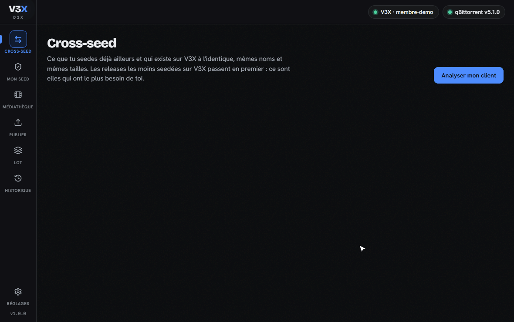
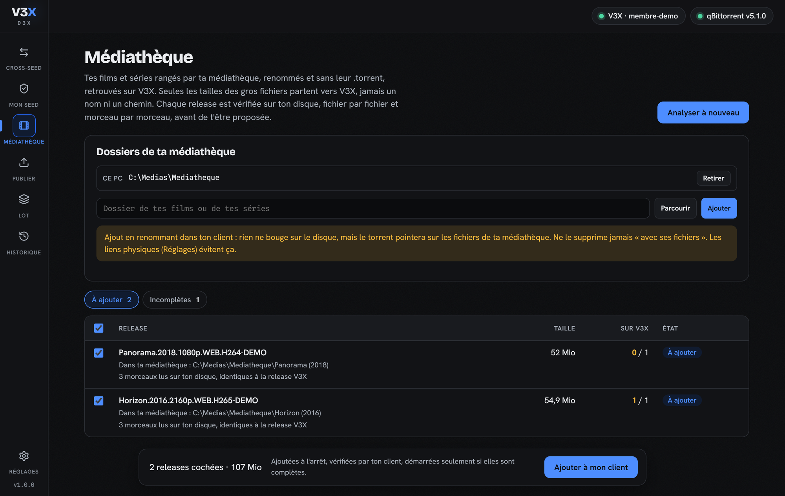
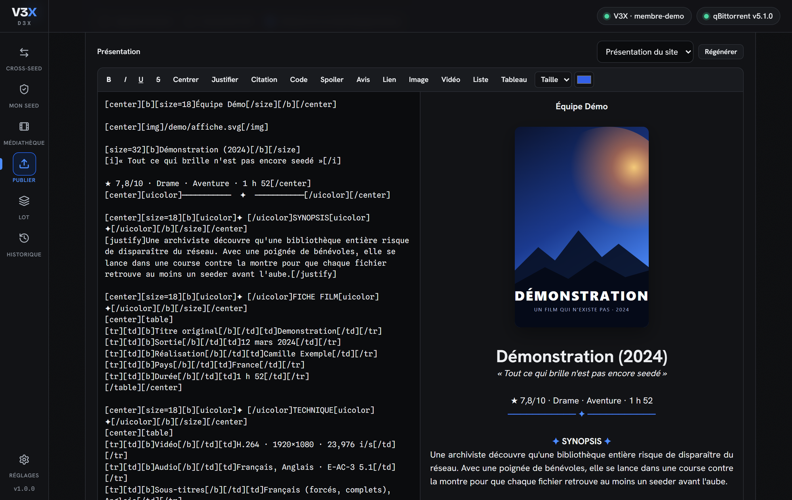
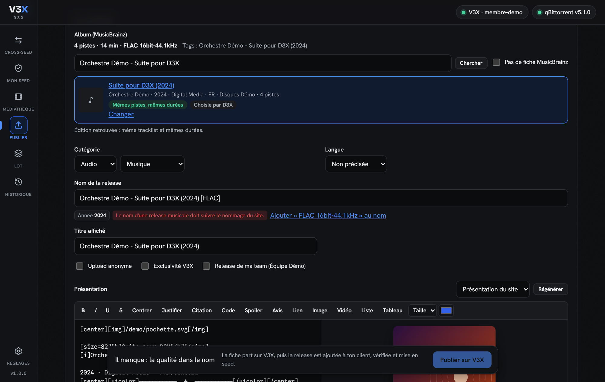
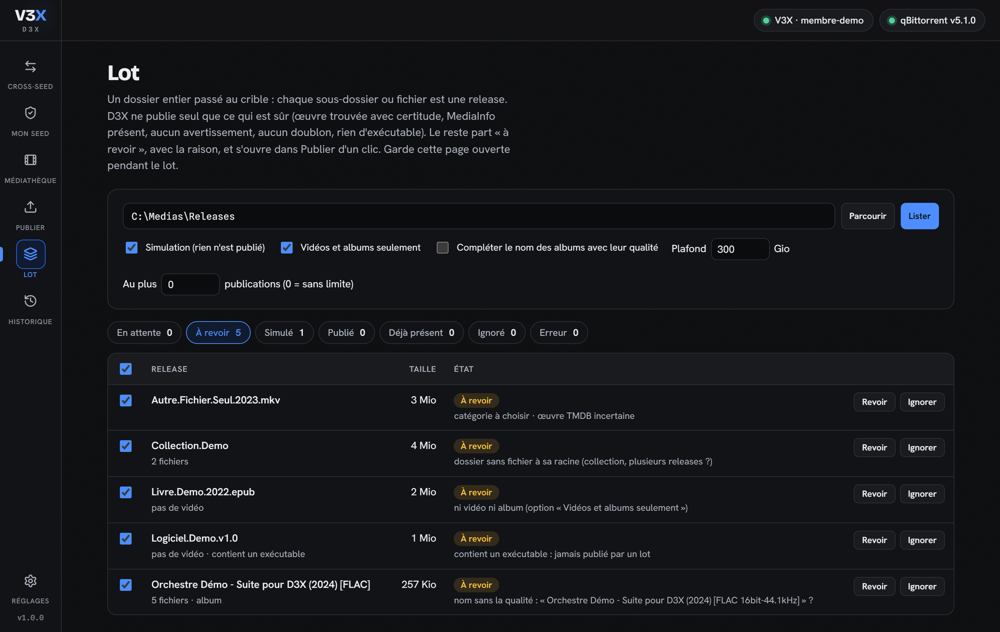
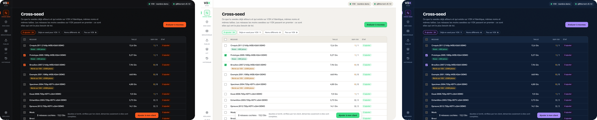

# D3X

L'outil de bureau des membres de [V3X](https://v3x.club).



- **Cross-seed** : D3X regarde ce que ton client torrent seede déjà pour d'autres trackers, retrouve sur V3X les releases identiques et les ajoute sur **les mêmes fichiers**. Tu seedes pour V3X sans rien retélécharger ni dupliquer sur ton disque. Les releases mortes et les relais primés passent en tête ; celles qui manquent à V3X se publient d'un clic, et celles qu'un membre demande sont signalées avec leur prime.
- **Médiathèque** : tes films et séries rangés et renommés, sans leur .torrent, retrouvés sur V3X et vérifiés morceau par morceau sur ton disque.
- **Mon seed** : ce que V3X attend de ton seed (hit and run à éviter, relais à reprendre) comparé à ce que fait vraiment ton client.
- **Surveillance** : D3X relance l'analyse tout seul, te prévient des nouvelles releases à cross-seeder et d'un hit and run en vue, et peut ajouter seul les releases identiques.
- **Publier** : tu choisis un dossier ou un fichier, sur ce PC ou sur ta seedbox, D3X fabrique le .torrent là où sont les fichiers pendant que tu remplis la fiche, que V3X prépare exactement comme sur sa page d'upload. Une fois publiée, la release part en seed dans ton client, sur les mêmes fichiers.
- **Musique** : D3X lit les tags et la qualité des pistes, retrouve l'album dans MusicBrainz en comparant les durées, et prépare la fiche album du site.
- **Lot** : un dossier entier passé au crible. D3X ne publie seul que ce qui est sûr ; le reste attend ta revue.

Clients pris en charge : **qBittorrent**, **Transmission**, **Deluge** et **rTorrent** (ruTorrent), sur ce PC, un NAS ou une seedbox, et [plusieurs à la fois](#plusieurs-clients) (une seedbox et ce PC, par exemple).

## Ce que fait D3X, et ce qu'il ne fait jamais

- **Il ne modifie ni ne supprime aucun de tes fichiers.** Pour publier, il lit tes fichiers (hachage, MediaInfo) ; pour le reste, tout passe par l'interface web de ton client. Sur une seedbox, il n'écrit que son agent dans `~/.d3x` et son cache de hachage dans `~/.config/D3X`. Seule exception, si tu l'actives : les [liens physiques](#les-liens-physiques), créés dans un dossier que tu choisis, sans jamais rien écraser.
- **Il ne télécharge rien à ta place.** Chaque release est ajoutée *à l'arrêt*, ton client vérifie les données, et D3X ne la démarre que si elle est complète à 100 %. Sinon elle reste arrêtée, avec un bouton pour la retirer (fichiers intacts ; avec rTorrent, D3X l'arrête et te laisse la retirer, car rTorrent peut être réglé pour effacer les données au retrait).
- **Cross-seed : il n'envoie à V3X que des empreintes.** Pour chaque torrent de ton client, D3X calcule chez toi deux empreintes (SHA-256 des chemins et des tailles, puis des tailles seules). Aucun nom de fichier, aucun chemin, aucun info-hash d'un autre tracker ne quitte ta machine.
- **Correspondance exacte seulement.** Une release n'est proposée que si ses fichiers ont exactement les mêmes tailles que sur V3X, fichier par fichier, et les mêmes noms (sinon elle va dans « Noms différents »), jamais sur la seule taille totale ni sur une ressemblance de nom. Le .torrent reçu de V3X est revérifié avant l'ajout, et le client vérifie chaque octet avant tout démarrage.
- **Médiathèque : seules les tailles des gros fichiers partent vers V3X** (plus de 50 Mio), jamais un nom ni un chemin. Les .torrent des releases trouvées sont ensuite comparés à tes fichiers chez toi.
- **Musique : seuls l'artiste et le titre de l'album partent vers [MusicBrainz](https://musicbrainz.org)** (base ouverte de la musique), interrogée directement, une requête par seconde comme elle le demande.
- **Publier : il envoie ce que tu enverrais sur le site**, le .torrent et la fiche (nom, catégorie, présentation, NFO avec le MediaInfo, sans aucun chemin local). Tes fichiers ne sont jamais envoyés à V3X.

Le code est ouvert : tu peux vérifier tout ce qui précède avant de lancer l'outil. Les appels au site sont tous dans [`internal/v3x`](internal/v3x).

## Cross-seed

L'analyse range tes releases en onglets :

- **À ajouter** : identiques sur V3X. Les **relais** passent en tête (releases rares lâchées par un membre : une prime en jetons aux premiers qui la reprennent, après 24 h de seed), puis les **releases mortes** (plus aucun seeder depuis trois jours : ton seed les ramène, et la prime de résurrection tombe une fois qu'elles ont servi).
- **Noms différents** : les mêmes fichiers sous d'autres noms (voir les [questions](#questions)).
- **Pas sur V3X** : ce que tu seedes ailleurs et qui manque à V3X. « Publier » ouvre la fiche d'une release, ou coches-en plusieurs pour les passer au crible du lot. Celles qui répondent à une **demande ouverte** sur le site sont en tête, avec la prime ; une fois ta release publiée et validée, D3X la propose au demandeur d'un clic.

D3X retrouve les fichiers d'une release sur ce PC, sur ta seedbox, ou sur un NAS si tu lui indiques où il voit les dossiers du client (Réglages ▸ Clients torrent ▸ Dossiers du client).

## Plusieurs clients

Tes films sur une seedbox dans Deluge, tes livres sur ce PC dans qBittorrent ? Règle les deux dans Réglages ▸ Clients torrent (huit au plus), chacun avec son nom (« Seedbox », « PC »), son adresse, et ses propres dossiers du client.

- **Analyse** : D3X interroge tous les clients en même temps et fusionne ce qu'ils seedent. Chaque ligne porte le nom de son client.
- **Chaque cross-seed part dans le client qui a déjà les fichiers**, avec le chemin que ce client connaît. Si deux clients ont les mêmes fichiers, une seule ligne, ajoutée au premier de la liste (« Monter » change l'ordre). Une release déjà présente dans l'un des clients n'est jamais proposée.
- **Un client injoignable ne bloque pas les autres** : un bandeau le signale (« Seedbox injoignable : … ») et l'analyse continue sans lui. Il est retenté au début de chaque analyse.
- **Mon seed et la surveillance** regardent tous les clients : une release en seed dans l'un d'eux est en seed. Si un client ne répond pas, ce qu'il seede n'est pas compté comme absent, et aucune alerte de hit and run n'en découle.
- **Publier** : la release part en seed dans le client dont les dossiers couvrent celui de la release, sinon celui qui seede déjà dans ce dossier, sinon celui qui tourne sur la machine des fichiers, sinon le premier. Tu peux en choisir un autre jusqu'à l'envoi.
- **Médiathèque** : tu choisis le client qui reçoit ses ajouts (le premier par défaut).
- **Liens physiques** : un dossier de liens par client, tel que ce client le voit.

Avec un seul client, rien ne change : mêmes écrans, aucune étiquette.

## Mon seed

- **Hit and run** : chaque release à seeder encore, le temps fait et l'échéance, comparés à l'état réel dans ton client (en seed, arrêtée, absente). Celles qui n'auront plus le temps d'y arriver passent en rouge, en tête.
- **Relais** : ceux que tu as déjà, ou que tu peux ajouter en cross-seed.
- **Releases V3X arrêtées** : complètes dans ton client mais arrêtées, elles ne seedent pas. Un bouton les redémarre (seulement les complètes : D3X ne lance jamais un téléchargement).

## Surveillance

Dans Réglages ▸ Surveillance, D3X relance l'analyse à intervalle régulier (de 15 minutes à 3 heures). Seuls les torrents arrivés depuis la dernière fois sont relus : ton client n'est presque pas sollicité.

- **Notification** sur ton bureau pour les nouvelles releases à cross-seeder et pour un hit and run en vue.
- **Ajout automatique**, si tu le coches : seulement les nouvelles releases identiques (mêmes fichiers, mêmes noms), jamais les « noms différents », avec la règle habituelle (à l'arrêt, vérifiées, démarrées à 100 %). Le premier passage ne fait que noter l'existant : ce qui était déjà là s'ajoute à la main.
- Fenêtre fermée, D3X reste dans la zone de notification. Sous Windows, il peut aussi se lancer avec la session, sans ouvrir sa fenêtre.

## La médiathèque

Une médiathèque renomme les fichiers et ne garde pas le .torrent : D3X les retrouve quand même.

1. Indique tes dossiers de films et de séries, sur ce PC ou sur ta seedbox.
2. D3X liste les fichiers et envoie à V3X **leurs tailles seules** (les gros fichiers). V3X répond par les releases qui ont un fichier de cette taille.
3. Pour chaque candidate, D3X lit son .torrent et cherche **chacun de ses fichiers** dans ta médiathèque, puis lit quelques morceaux de chaque fichier sur ton disque et compare leur empreinte à celle du .torrent. Une taille identique ne suffit jamais.
4. Tu coches ce que tu veux seeder. L'ajout se fait par [liens physiques](#les-liens-physiques) si tu les as activés (ta médiathèque n'est jamais touchée), sinon en renommant dans ton client, comme pour les « noms différents ».

Une release dont il manque un fichier (souvent un petit .nfo) est signalée « incomplète » : ton client ne pourrait pas la vérifier à 100 %, elle n'est pas proposée.



## Les liens physiques

Certains clients ne savent pas renommer les fichiers d'un torrent (rTorrent), et D3X refuse de renommer quand un nom pourrait déjà exister. Dans Réglages ▸ Liens physiques, choisis un **dossier de liens**, tel que ton client le voit (un par client si tu en as plusieurs) : D3X y range la release V3X, chacun de ses fichiers étant un lien physique vers le fichier de ta copie.

- Aucune place en plus : un lien physique est le même fichier sous un autre nom.
- Ta copie n'est pas touchée, et rien n'est jamais écrasé : un lien ne se crée que là où il n'y a rien. Si l'ajout échoue, les liens sont retirés, et D3X n'efface un lien que s'il pointe bien vers ta copie.
- Le dossier doit exister, sur le même disque que tes fichiers, et D3X doit le voir : sur ce PC, par un partage avec les dossiers du client, ou sur ta seedbox par son agent.

## Publier, en mieux

- **Doublon repéré avant de hacher** : l'empreinte des noms et tailles suffit pour savoir si la release existe déjà sur V3X, sans passer dix minutes à hacher 50 Gio pour rien.
- **Hachage sur tous les cœurs**, mémoire bornée, et un cache : une release déjà hachée ne l'est plus jamais.
- **MediaInfo sans rien installer** : la même bibliothèque que la page d'upload du site, calculée dans la page de D3X.
- **La fiche est celle du site** : nom suggéré, catégorie, TMDB, NFO et présentation viennent du même générateur que la page d'upload de V3X. Éditeur avec barre d'outils et aperçu en direct.
- **Seed automatique**, même quand ton client tourne sur un NAS ou dans Docker : D3X devine où le client voit tes fichiers, d'après les torrents qu'il seede déjà.
- Fichiers cachés et aperçus de médiathèque écartés (`.DS_Store`, `*.trickplay`, `extrafanart`…), liens symboliques suivis sans boucle, fichier encore en cours d'écriture détecté.



## La musique

Un dossier d'album (une ou plusieurs pistes, plusieurs disques compris) est reconnu tout seul.



- **Tags et qualité lus sur place**, sur ce PC ou sur la seedbox : FLAC, MP3, M4A (AAC, ALAC), Ogg Vorbis, Opus, WAV et DSF. Seuls les en-têtes sont lus.
- **L'album retrouvé dans MusicBrainz** : chaque édition est comparée aux pistes, leur nombre puis leurs durées à deux secondes près. L'édition désignée par les tags (Picard, beets…) est reprise telle quelle. Entre un CD et une édition numérique aux mêmes pistes, le support noté dans les tags l'emporte.
- **La fiche album du site** (jaquette, tracklist, label), dans Audio ▸ Musique.
- **Le nom** : V3X exige la qualité dans le nom d'un album (`FLAC 24bit-96kHz`, `MP3 320`). D3X la lit dans les fichiers et propose de l'ajouter d'un clic.

Le lot ne publie seul un album que si l'édition est certaine (tags, ou mêmes pistes aux mêmes durées, d'une seule œuvre) et que toutes les pistes ont la même qualité. Un nom sans la qualité part « à revoir » avec le nom corrigé, ou est complété si l'option du lot est cochée.

## Depuis une seedbox (SSH)

Tes releases sont sur une seedbox ? Pas besoin de les rapatrier : dans Réglages ▸ Seedbox (SSH), indique l'adresse, ton utilisateur et ton mot de passe (ou ta clé SSH). Publier et Lot proposent alors « Ce PC » ou ta seedbox.

- D3X y dépose son **agent** (un petit programme Linux de 1,4 Mio, compilé avec chaque version, dans `~/.d3x`) qui liste, hache et lit les fichiers **sur place**. Seuls la liste des fichiers, le .torrent et les morceaux lus par MediaInfo reviennent sur ton PC, par la connexion SSH chiffrée.
- L'agent est vérifié par son empreinte SHA-256 avant chaque usage ; il est remplacé à la version suivante de D3X.
- **Clé d'hôte vérifiée** : à la première connexion, D3X te montre l'empreinte de la seedbox et attend ton accord. Si elle change ensuite, tout est bloqué jusqu'à ce que tu acceptes la nouvelle.
- **Le mot de passe n'est jamais enregistré** : il reste en mémoire le temps de la session. Avec une clé SSH sans phrase de passe, la seedbox se reconnecte seule au lancement.
- Aucun nom de fichier ne passe par le shell de la seedbox : chaque demande à l'agent part en un seul argument encodé.
- Le client torrent de la seedbox doit être dans tes clients (Réglages ▸ Clients torrent) : la release publiée part en seed sur les mêmes fichiers.

Seedbox sous Linux x86_64 ou arm64.

## Le lot

Chaque sous-dossier ou fichier d'un dossier est une release. D3X la publie seule **seulement** si l'œuvre TMDB est trouvée avec certitude (même titre, même année à un an près, bon type), que la catégorie est connue, que le MediaInfo est lu et que V3X n'annonce aucun refus. Jamais pour un exécutable, une collection sans fichier à sa racine ou une release au-delà du plafond de taille. Le reste part « à revoir », avec la raison, et s'ouvre dans Publier d'un clic.

Simulation par défaut, plafond de publications, pause entre deux publications, arrêt propre. Les décisions sont gardées : un lot interrompu reprend où il en était, ce qui est publié n'est plus proposé.



## Aux couleurs de V3X

Le logo, la barre latérale et les polices du site, pour ne pas être perdu. D3X reprend le fond et la couleur d'accent choisis sur ton profil V3X ; tu peux aussi les changer dans Réglages ▸ Apparence (trois fonds, huit accents).



## Installer

1. Télécharge le fichier de ton système dans les [versions publiées](https://github.com/V3x0rV3x/D3X/releases/latest) :
   - Windows : `d3x_windows_amd64.exe`
   - macOS : `d3x_darwin_arm64` (puces Apple) ou `d3x_darwin_amd64` (Intel)
   - Linux : `d3x_linux_amd64` ou `d3x_linux_arm64`
2. Lance-le. D3X s'ouvre dans sa propre fenêtre ; sous Windows, son icône apparaît aussi près de l'horloge (clic pour rouvrir la fenêtre, clic droit ▸ Quitter). Tout reste sur ta machine (`http://127.0.0.1`). Fermer la fenêtre arrête D3X, sauf s'il a un travail en cours (il le termine d'abord) ou si la surveillance est active (il reste dans la zone de notification).

Les mises à jour s'installent d'un clic depuis D3X, et seulement après deux vérifications : la liste des empreintes doit être signée par la clé de V3X, et le fichier doit avoir l'empreinte annoncée.

Premier lancement :

- **Windows** affiche parfois « Windows a protégé votre ordinateur » pour un programme qu'il ne connaît pas encore : *Informations complémentaires*, puis *Exécuter quand même*.
- **macOS** : `xattr -d com.apple.quarantine d3x_darwin_*` puis `chmod +x d3x_darwin_*`, ou clic droit ▸ Ouvrir.
- **Linux** : `chmod +x d3x_linux_*`.

### Sur un NAS ou un serveur (Docker)

L'image `ghcr.io/v3x0rv3x/d3x` (amd64 et arm64) contient le même binaire que la version publiée, en mode serveur : pas de fenêtre, la page s'ouvre depuis n'importe quel appareil du réseau.

```yaml
services:
  d3x:
    image: ghcr.io/v3x0rv3x/d3x:latest
    container_name: d3x
    restart: unless-stopped
    ports:
      - "8733:8733"
    volumes:
      - d3x:/config
      - /chemin/vers/tes/medias:/data:ro
volumes:
  d3x:
```

1. `docker compose up -d`, puis `docker compose logs d3x` : le journal donne le lien d'accès, `http://ADRESSE-DE-CETTE-MACHINE:8733/auth?t=…`. Le jeton est gardé dans `/config` (ou choisi avec `D3X_TOKEN`) ; le navigateur s'en souvient 400 jours.
2. Dans Réglages, l'adresse du client torrent est celle de son conteneur (`http://qbittorrent:8080`) ou de la machine, jamais `127.0.0.1`.
3. Tes médias sont montés en lecture seule : D3X n'écrit jamais dedans. S'il n'a pas le droit de les lire, lance-le avec l'utilisateur qui les possède (`user: "1000:1000"`, voir `id -u` et `id -g`).
4. Mise à jour : `docker compose pull && docker compose up -d`. D3X signale les nouvelles versions mais ne se remplace pas lui-même dans un conteneur.

Le jeton protège la page : ne publie pas le lien, et derrière un proxy https, le cookie passe en `Secure`. Le binaire seul fait pareil avec `d3x -listen 0.0.0.0:8733`.

### Vérifier un téléchargement

Chaque version publie `checksums.txt` (l'empreinte SHA-256 de chaque fichier) et `checksums.txt.sig`, la signature de cette liste par la clé de V3X. La clé publique est dans ce dépôt : [`d3x-signature.pub`](d3x-signature.pub).

1. Vérifie que la liste vient bien de V3X (OpenSSL 3, fourni avec Git sous Windows) :
   ```sh
   openssl pkeyutl -verify -pubin -inkey d3x-signature.pub -rawin -in checksums.txt -sigfile checksums.txt.sig
   ```
   La réponse doit être `Signature Verified Successfully`.
2. Compare l'empreinte de ton fichier avec la sienne dans la liste : `sha256sum d3x_linux_amd64`, ou `certutil -hashfile d3x_windows_amd64.exe SHA256` sous Windows.

## Régler

1. **Ta clé API V3X** : [Réglages ▸ Intégrations](https://v3x.club/settings?tab=integrations) sur le site, avec le droit « Torznab » (cross-seed) et le droit « Upload » (publier).
2. **Ton client torrent**, par son interface web, ou plusieurs (« Ajouter un autre client »). Le bouton *Détecter sur ce PC* trouve ceux qui tournent ici. « Tester la connexion » essaie un client sans rien enregistrer.
3. **Ta seedbox** (facultatif), par SSH, pour publier ce qui s'y trouve.
4. **Les dossiers du client** (facultatif), pour chaque client : s'il tourne ailleurs (NAS, Docker), une ligne par dossier, son chemin ici et le même vu par le client.

| Client | Adresse habituelle | À activer |
| --- | --- | --- |
| qBittorrent (4.5+) | `http://127.0.0.1:8080` | Outils ▸ Options ▸ Interface Web |
| Transmission | `http://127.0.0.1:9091` | Préférences ▸ Distant |
| Deluge | `http://127.0.0.1:8112` | greffon WebUI (mot de passe seul) |
| rTorrent | `https://ta-seedbox/RPC2` | XML-RPC, avec l'identification de la seedbox |

Les réglages restent sur ta machine, lisibles par toi seul :

| Système | Dossier |
| --- | --- |
| Windows | `%AppData%\D3X` |
| macOS | `~/Library/Application Support/D3X` |
| Linux | `~/.config/D3X` |

## Questions

**Un cross-seed compte-t-il comme un téléchargement ?** La release apparaît dans tes téléchargements sur V3X, mais comme tu n'as reçu aucun octet, le hit and run ne s'applique pas aux cross-seeds.

**V3X refuse le .torrent ?** Si ton ratio est sous le plancher ou si tu as trop de hit and run non régularisés, le site bloque les nouveaux .torrent, cross-seed compris. D3X affiche la raison. Tes propres publications ne sont jamais bloquées.

**Et l'onglet « Noms différents » ?** Ce sont les mêmes fichiers que sur V3X sous d'autres noms (dossier renommé, épisodes renommés par ta médiathèque…). D3X ajoute la release V3X à l'arrêt, donne à ses fichiers les noms de ta copie *dans le client* (chaque fichier V3X associé à un fichier de même taille), puis lance la vérification : elle ne démarre qu'à 100 %, sinon elle reste arrêtée. Rien n'est créé, déplacé ni renommé sur ton disque. Par prudence, D3X refuse quand un nom de la release V3X existe déjà, car le client déplacerait ce fichier : autre fichier de ta copie, autre torrent du client, ou fichier présent sur le disque. Le disque est vérifié par D3X quand il le voit (même machine, ou dossier partagé avec une correspondance de chemins), sinon demandé au client (qBittorrent 5, Deluge) ; quand personne ne peut le vérifier, D3X refuse au lieu de deviner. Possible avec qBittorrent, Deluge et Transmission (même rangement des dossiers, disque vu par D3X) ; rTorrent ne sait pas renommer les fichiers d'un torrent.

**Mon client tourne sur un NAS.** Publier lit les fichiers depuis ce PC (partage réseau) et ton client les seede là où il les voit : D3X traduit le chemin, en le devinant d'après les torrents que le client seede déjà dans ce dossier. Tu peux le corriger, il s'en souviendra (dans les dossiers de ce client).

**Une seedbox et des fichiers sur ce PC ?** Règle les deux clients : D3X les analyse ensemble, et chaque cross-seed part dans le client qui a les fichiers. Voir [Plusieurs clients](#plusieurs-clients). Les réglages restent lisibles par D3X 1.0 : il n'y retrouverait que le premier client.

## Compiler soi-même

Go 1.26 ou plus :

```sh
go test ./...
sh scripts/build-agents.sh   # agent de seedbox, facultatif
go build -trimpath -o d3x .
```

Sans `scripts/build-agents.sh`, tout marche sauf la seedbox.

Pour regarder l'interface sans compte ni client torrent, le mode démo lance la page avec un faux qBittorrent, un faux V3X et un faux MusicBrainz, peuplés de releases inventées, avec une médiathèque, des demandes et des relais (c'est lui qui a servi aux captures) :

```sh
D3X_DEMO=600 go test ./internal/server -run 'TestDemo$' -v
```

puis ouvrir `http://127.0.0.1:8799/auth?t=demo`. Avec `D3X_DEMO_CLIENTS=1`, la démo a trois clients : une seedbox, ce PC et un NAS éteint.

## Licence

[MIT](LICENSE). MediaInfo : [mediainfo.js](https://github.com/buzz/mediainfo.js) 0.3.7 (MediaInfoLib), licence BSD-2-Clause, voir [`internal/server/ui/vendor/mediainfo`](internal/server/ui/vendor/mediainfo).
